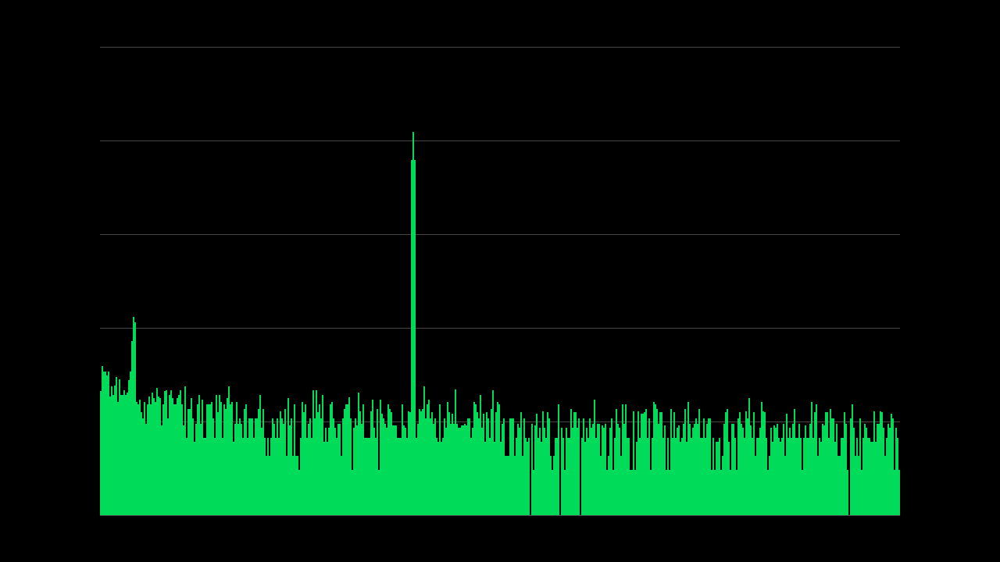
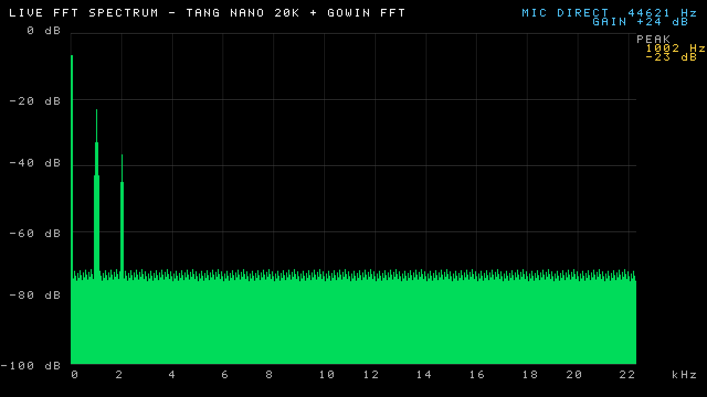

# 12 — HDMI demo: live microphone spectrum on a monitor

Plan: `docs/plans/hdmi-demo.md`. Requested by the advisor after the FFT benchmark report:
microphone → Tang Nano 20K → Gowin FFT → spectrum on a monitor over the board's HDMI port.

| Step | What | Status |
|---|---|---|
| **H1** | Colour test pattern at 1280×720, 60 Hz | ✅ 2026-10-09 |
| **H2** | Spectrum of a test tone generated inside the FPGA | ✅ 2026-10-09 |
| **H3** | Live spectrum from the INMP441 microphone | ✅ 2026-10-21 (direct mic, pins 25/26/29) |
| **H4** | Gridlines, kHz/dB labels, peak readout | ✅ 2026-10-22 (mic at 44,621 Hz) |

---

## 1. How HDMI sends a picture

**A frame is more than the visible picture.** After every line and every frame comes invisible
*blanking* time. It's a leftover from CRT monitors (the beam needed time to fly back), and it is
where the sync pulses live: **HSYNC** = "new line", **VSYNC** = "new frame". The exact totals are
fixed by the standard (CEA-861), which is how a monitor recognises the format:

```
 ◀──────────────────────── 1650 slots per line ─────────────────────────▶
 ┌──────────────────────────────────────┬──────┬──────┬──────────────────┐ ▲
 │                                      │front │ sync │   back porch     │ │
 │        VISIBLE PICTURE 1280 × 720    │porch │  40  │      220         │ │ 720 lines
 │                                      │ 110  │      │                  │ │
 ├──────────────────────────────────────┴──────┴──────┴──────────────────┤ ▼
 │  vertical blanking: 5 front porch + 5 sync + 20 back porch = 30 lines │
 └───────────────────────────────────────────────────────────────────────┘
   1280 + 370 = 1650 slots per line,   720 + 30 = 750 lines per frame
```

**Each pixel travels as bits.** A pixel is 3 colours × 8 bits. HDMI has one wire pair per
colour; each 8-bit value is coded into a **10-bit TMDS word** and sent one bit after another,
bit 0 first. A fourth pair carries the clock.

**TMDS coding** (DVI 1.0, `src/hdmi/tmds_encoder.v`) solves two problems of a fast cable:
1. *Fewer transitions:* the byte is rewritten as an XOR (or XNOR) chain, whichever toggles
   less; bit 8 records which.
2. *Balance of 1s and 0s:* a running count of "1s minus 0s" is kept, and a word is sent
   inverted when the count leans one way; bit 9 records the inversion.

During blanking, one of four fixed control words is sent instead; on the blue lane they carry
HSYNC and VSYNC. The monitor undoes both steps, so the colours arrive unchanged.

## 2. The clocks: why 371.25 MHz is fine

```
 27 MHz crystal ─▶ rPLL ×55 ÷4 ─▶ 371.25 MHz ─────────────▶ 4 × OSER10 serializers ONLY
                                      └─▶ CLKDIV ÷5 ─▶ 74.25 MHz ─▶ timing, pattern, TMDS encoders
 27 MHz crystal ──────────────────────────────────────────▶ ESP32 UART benchmark (until 2026-10-29; now its own build)
```

| Clock | Calculation | Used by |
|---|---|---|
| **74.25 MHz** pixel clock | 1650 × 750 slots × 60 frames | everything that makes the picture |
| **371.25 MHz** serializer clock | 74.25 M pixels × 10 bits = 742.5 Mbit/s per wire; sent on both clock edges → ÷2 | only the 4 serializers |

- **OSER10** is a serializer built into the pin's I/O block: it takes 10 bits once per pixel and
  shifts them out at the fast clock. It is designed for this speed; our own logic never sees
  that clock (like a cashier handing 10 coins at a time to a fast coin machine).
- **TLVDS_OBUF** drives each serial bit as a differential pair (P/N), as HDMI needs.
- PLL: VCO = 371.25 × 2 = 742.5 MHz (allowed 500–1250). The same numbers as Sipeed's official
  20K HDMI example, whose pin list (33–40) is also used here.
- **No IP core was generated**: rPLL, CLKDIV, OSER10 and TLVDS_OBUF are Gowin built-in blocks
  used directly in Verilog.

## 3. H1: colour test pattern

### 3.1 The picture

| Element | Checks |
|---|---|
| 8 colour bars (white, yellow, cyan, green, magenta, red, blue, black) | each colour lane wired correctly |
| 1-pixel white border | the whole 1280×720 is visible, nothing cropped |
| grey ramp, black → white | all 8 bits of each colour arrive |
| moving 40×40 square (4 px per frame) | the picture is live |

### 3.2 Simulation first, down to the serial bits

`fpga_fft/sim/tb_hdmi.v` runs the picture chain with **Gowin's own models** of CLKDIV and OSER10
and records every bit leaving the 4 lanes (2 frames, ~25 million bits, ~2.5 min in Icarus).
`fpga_fft/sim/check_hdmi.py` then decodes the stream **like a monitor**: word alignment from the
clock lane, TMDS decoding, sync recovery, and a pixel-by-pixel comparison.

| Check (complete frame between two VSYNCs) | Result |
|---|---|
| clock lane = 5 zeros + 5 ones per pixel | ✅ 100 % |
| 720 visible lines × 1280 pixels; 1650 slots/line; 750 lines/frame | ✅ exact |
| HSYNC 40, front porch 110, back porch 220 | ✅ exact |
| VSYNC 5 lines, starting at line 725, slot 1390, together with HSYNC | ✅ exact |
| DC balance within each line, all 3 lanes | ✅ worst running 1s − 0s: 9 |
| **every visible pixel decoded back to the expected colour** | ✅ **0 of 921,600 differ** |

Found and fixed on the way:
1. **VSYNC started one slot after HSYNC** (it passed through one register too many). The
   standard starts them together. Fixed in `video_timing.v`.
2. The moving square stepped once per clock during reset (`frame_start` wasn't gated by
   reset), so it started at x = 84 instead of 4. Cosmetic; fixed.
3. Gowin's CLKDIV model only starts counting after a low-to-high step on `RESETN`. On the
   chip, `RESETN` is the PLL's lock signal, which does exactly that; the testbench now mimics it.

### 3.3 Build and hardware result

| | Value |
|---|---|
| Logic / registers | 2,046 (10 %) / 789, including the ESP32 benchmark |
| Pixel clock | needs 74.25 MHz, timing met up to 93.3 MHz |
| Benchmark clock | needs 27 MHz, met up to 83.9 MHz |
| ESP32 benchmark inside the HDMI build | echo 26 / 26 ✅ |
| **Monitor (4K, 27")** | **picture exactly as designed; monitor reports 1280×720 @ 60 Hz** ✅ |

The 4K monitor scales the picture itself: 3840 ÷ 1280 = 2160 ÷ 720 = 3, so each pixel is shown
as a clean 3×3 block.

```bash
DESIGN=hdmi fpga_fft/build.sh program          # build + load the HDMI design
iverilog -g2012 -s tb_hdmi -o /tmp/tb_hdmi fpga_fft/sim/tb_hdmi.v fpga_fft/src/hdmi/*.v \
    /Applications/GowinIDE.app/Contents/Resources/Gowin_EDA/IDE/simlib/gw2a/prim_sim.v
vvp /tmp/tb_hdmi +out=/tmp/hdmi_bits.txt && python fpga_fft/sim/check_hdmi.py /tmp/hdmi_bits.txt
```

---

## 4. H2: spectrum of a test tone

### 4.1 The chain

```
 tone_gen ─▶ gain ─▶ clamp ─▶ × Hann ─▶ ping-pong ─▶ Gowin FFT ─▶ re²+im² ─▶ log2 ─▶ height ─▶ bar memory ─▶ screen
 (48.3 kHz)  (param) (param)   window    buffer      (2nd core,    (power)              (px)     (2 halves,
                                         2 × 1024     74.25 MHz)                                 swap in blanking)
```

| Block (`src/hdmi/`) | Job |
|---|---|
| `tone_gen.v` | Test signal at the microphone's sample rate (74.25 MHz ÷ 1536 = 48,339.8 Hz): a half-scale tone sweeping 0 → 24 kHz in ~10 s, plus a fixed 1 kHz tone 40 dB quieter. Each tone is a phase accumulator (a 32-bit counter stepping once per sample) indexing a 1024-entry sine table |
| `spectrum.v` | Gain (`GAIN_SHIFT`) and clamp (`CLAMP`, default 32,700) — both parameters to tune for the microphone; Hann window; two-half sample buffer; a second Gowin FFT core; power = re² + im² for bins 0–511; height in pixels |
| `bar_display.v` | 512 bars × 2 px from x = 128, gridlines every 20 dB; double-buffered heights, swapped during vertical blanking |
| `rom_sine.v`, `rom_hann.v` | Lookup tables, generated by `fpga_fft/gen_tables.py` |

### 4.2 The dB scale: why 0 dB is at the top

dB compares a value with a **reference**. Here the reference is the **largest value an FFT bin
can hold, 32,767** ("full scale", 0 dBFS). Nothing can be bigger, so 0 dB is the ceiling at the
top, and every real signal is negative, further down. Each 20 dB down is 10× smaller:

| Bin value | Fraction of max | dB | Screen |
|---|---|---|---|
| 32,767 | 1 | 0 dB | top (600 px) |
| 3,277 | 1/10 | −20 dB | 2nd gridline |
| 328 | 1/100 | −40 dB | 3rd gridline |
| 33 | 1/1,000 | −60 dB | 4th gridline |
| 3 | 1/10,000 | −80 dB | 5th gridline |
| 0.3 | 1/100,000 | −100 dB | bottom |

On a linear scale the 1 kHz tone (1/100 of the main tone) would be 1 % as tall: invisible. The
dB scale shows strong and weak signals on one screen.

**How the height is computed in hardware** (6 px per dB, 0 dB at 600 px, −100 dB at 0 px):
height = 60·log10(P) + 58.15 with P = re² + im² (P = 32,767² is 0 dB). log10 is avoided:
log2(P) = position of P's highest 1-bit + a 32-entry table for the fraction (in 1/32 steps,
L = 32·log2 P), then **height = (289·L + 29,773) / 512**, clipped to 0…600.

**Why the main tone shows at −18 dB:** half-scale input (−6 dB) → a real tone's energy splits
between bin k and its mirror 1024 − k (−6 dB) → the Hann window halves the average (−6 dB).

### 4.3 Timing: does each step keep up?

| Step | Time | Margin |
|---|---|---|
| Collect 1,024 samples (one every 1,536 clocks) | 21.2 ms | — |
| FFT on a finished block | 7,190 clocks = 0.097 ms | 0.5 % of the time available |
| Power → dB → height | one bin per clock during the FFT's unload, +6 clocks | — |
| New bars on screen | at the next vertical blanking (≤ 16.7 ms) | never mid-picture: no tearing |

The two-half buffer means the FFT works on one half while the other fills: no sample is lost.
`overrun` (LED 4) would light if a block arrived while the FFT was still busy; it can't
happen with this margin, and it stayed off.

### 4.4 Simulation

| Check (`sim/tb_h2_audio.v`, `sim/tb_h2_video.v`, `sim/check_h2.py`) | Result |
|---|---|
| Tone samples vs a Python model of the phase accumulators | **bit-exact** (2,497 samples) |
| Windowed block vs gain/clamp/Hann in Python | **bit-exact** |
| FFT (Gowin gate-level model) vs numpy | correct, 2.54 LSB rms |
| 512 heights vs the formula applied to the FFT output | **bit-exact** |
| Tone 1 (fixed at bin 200) / tone 2 (1 kHz) | bin 200 at −18.2 dB / bin 21, 39.5 dB lower |
| Everything away from the tones | below −68 dB |
| One full frame of pixels vs the layout | **0 of 921,600 differ** |

In simulation a sample comes every 16 clocks instead of 1,536 (frequencies are set per sample,
so the spectrum is the same) to keep the gate-level FFT run to ~7 s.



*The simulated frame: tone at bin 200 (−18 dB), the 1 kHz tone (−58 dB) on the left, and the
FFT's own rounding noise as "grass" around −80 dB — the noise floor from the benchmark, now
visible.*

Caught before the hardware: a hand-typed log2 table with 12 of 32 entries off by one (now
generated), and a testbench that stopped before the FFT's mirror half was out.

### 4.5 Build and hardware result

| | Value |
|---|---|
| Logic / registers | 3,199 (16 %) / 1,190 |
| Block RAM | 19 / 46: benchmark FFT 6 + demo FFT 6 + benchmark buffer 2 + sample buffer 2 + sine 1 + Hann 1 + bars 1 |
| DSP | 7 / 24 |
| Pixel clock | needs 74.25 MHz, met up to 81.5 MHz |
| ESP32 benchmark in the same build | passes |
| **Monitor** | **the tone sweeps across the screen as designed** ✅ |

---

## 5. H3: the live microphone ✅

### 5.1 Three sources, selectable with button S1

| Source | Path | Modules |
|---|---|---|
| **Direct (default)** | INMP441 → FPGA pins 25 (SCK), 26 (WS), 29 (SD) | `mic_source.v` + `fpga/src/i2s_master_rx.v` (24-bit output) |
| ESP32 relay | INMP441 → ESP32 I2S → UART 2.97 Mbaud (GPIO17 → pin 27) → FPGA | `firmware/mic_relay`, `relay_rx.v` |
| Test tone | as in H2 | `tone_gen.v` |

S1 steps direct → relay → tone → direct. Both microphone paths use `gain24.v`: the 16-bit
sample is a window of the 24-bit word, moved down 0…7 bits (+0…+42 dB, button S2, **start
0 dB** = the top 16 bits), saturated, then clamped to ±32,700.
Relay packet: `B5 6A | seq | 32 × 24-bit (LE) | sum16` = 101 bytes, 1,500 /s, 51 % of the link;
a packet with a wrong sum is dropped, one that stalls 1 ms is abandoned.

> **2026-10-22: the ESP32 relay is out of the build.** The direct mic works, so S1 now
> switches between just two sources: **direct mic ↔ test tone**. `relay_rx.v`,
> `tb_h3_relay.v` and `firmware/mic_relay` stay in the repo as a record, but the HDMI build no
> longer uses them. LEDs 1 and 3 (relay source, relay packets) are now unused, and LED 4 shows
> only an FFT overrun.

**Direct-mic clocks.** H3 first worked at 74.25 MHz ÷ 77 = 964.3 kHz bit clock (15,067
samples/s, 2026-10-21), the rate proven by the mic check. The rate was then raised step by step,
each step confirmed on the monitor:

| `MIC_BCLK_DIV` (video_h3.v) | Bit clock | Sample rate | Screen span | Hz per bar | Seen clean |
|---|---|---|---|---|---|
| 77 | 964.3 kHz | 15,067 Hz | 0–7.5 kHz | 14.7 | 2026-10-21 |
| 39 | 1.904 MHz | 29,748 Hz (≈ 2×) | 0–14.9 kHz | 29.0 | 2026-10-22 |
| **26 (current)** | **2.856 MHz** | **44,621 Hz** (closest to 44.1 kHz; ÷27 gives 42,969) | 0–22.3 kHz | 43.6 | 2026-10-22 |

Exactly 2× (÷38.5) or exactly 44.1 kHz would need a different clock. The test tone now runs at
the same rate as the mic (§6). SCK/WS drive 8 mA.

### 5.2 Verified in simulation

| Test | Result |
|---|---|
| `tb_h3_mic`: INMP441 model timed like the real chip, 8 gain copies | bit-exact incl. saturation; SCK exactly 26 clocks (2.856 MHz), a sample every 1,664 clocks (also run at 77 and 39) |
| `tb_h3_relay`: packets at the ESP32's real baud (2,969,838) | 192 / 192 samples bit-exact; corrupted packet dropped; half packet abandoned |
| `fpga/sim/run_sims.sh` (audio project, shared `i2s_master_rx`) | all pass |

### 5.3 How the hardware got there (2026-10-09 → 10-21)

The first build ran the mic at 3.09 MHz on pins 25/26/29 and saw nothing (SD never high);
the mic connection was unstable even on the ESP32. To debug without the HDMI chain in the
way, a separate **mic check** build was made (`fpga_fft/src/top_mic_uart.v`, `DESIGN=mic`):
mic → 20K → UART → ESP32 bridge → `host/inmp441_viewer.py`, on the 27 MHz crystal with no PLL,
with a built-in 1 kHz test tone (S1) to prove the link on its own and a raw-bits mode (S2)
that sends every SD bit (read by `host/sd_raw.py`).

| Setup | Result |
|---|---|
| Mic check, test tone | 1 kHz exact, 0 frames lost: the link works |
| Mic on the **ESP32**, scope probe on SCK | scrambled. Probing SD or WS alone was fine; **probing SCK broke it** |
| Mic on the ESP32, no probe (3.07 MHz) | clean: correlation 0.99, 220 Hz shown |
| 20K pins 73/74/75, then SCK 76; 643 kHz; 4 / 8 mA; 2.25 MHz | scrambled or shifted words (values −64, −128, 32767; correlation ≈ 0.06) |
| Two receiver fixes (§5.4) | correct in simulation, no visible change on the board |
| Raw bits | SD active in both halves of the frame, no fixed start bit |
| **Tang Nano 4K** (pins 39/40/41, 964 kHz, same receiver) | clean: 220 / 440 Hz; quiet-room correlation 0.77 |
| **20K pins 25/26/29, 964 kHz** (27 MHz ÷ 28), 8 mA | clean: quiet-room correlation 0.954, values −54…47; 220 / 440 Hz confirmed |
| **H3 on the monitor**, same pins and clock | ✅ works |

The 4K result cleared both the microphone and the shared receiver logic. On the 20K two things
changed together in the run that worked (pins and bit clock), so which one mattered is not
known; the demo keeps both.

### 5.4 Two receiver timing fixes (`fpga/src/i2s_master_rx.v`)

Neither was the cause of the scrambled data, but both are real faults and are kept:

1. **SCK and WS now come straight from flip-flops.** They used to be decoded from the divider
   counter with logic. When a counter changes several bits at once, the logic output can
   briefly flick to a wrong value (a *glitch*) before it settles. The mic would count a
   glitch on SCK as an extra clock edge.
2. **WS now changes when SCK falls, not when it rises.** The INMP441 reads WS on the rising
   SCK edge. Changing WS on that same edge is a race: the mic may read the old or the new
   value, so its frame can start one bit early or late. On the falling edge WS is steady
   long before the mic reads it. The capture start moved with it (`CAP_START` 2 → 1), and
   the simulation mic models now read WS on the rising edge and change SD on the falling
   edge, like the real chip.

### 5.5 Lessons

- **Don't probe SCK while testing.** A scope probe is a capacitor and a long wire; on a fast
  clock edge that can create extra edges at the mic.
- **Isolate with a known-good reference.** Swapping in the 4K (the same mic, the same receiver
  logic, a different board) answered in one run what a week of changes on the 20K could not.

---

## 6. H4: labels and a peak readout ✅



*One whole frame rendered by the simulation (`tb_h4_frame.v`) from a fake spectrum with a 1 kHz
peak at −23 dB: what `hdmi_out` receives, pixel for pixel. The same layout is on the monitor.*

### 6.1 What is on the screen

| Part | Where | Detail |
|---|---|---|
| Title, source, sample rate | top row | "LIVE FFT SPECTRUM - TANG NANO 20K + GOWIN FFT", "MIC DIRECT 44621 Hz" or "TEST TONE 44621 Hz" (S1) |
| Gain | under it | "GAIN +24 dB", follows S2 at once |
| dB labels | left, at the gridlines | 0 to −100 dB, every 20 dB |
| kHz axis | bottom | a label and a dim tick line every 2 kHz; mic and test tone both span 0–22.3 kHz (the ESP32 relay, 0–24 kHz, was removed on 2026-10-22) |
| Peak readout (yellow) | right | the loudest bin of the latest FFT, about 4 times a second: "1002 Hz", "-23 dB". Below −80 dB: "---" |

### 6.2 How text is drawn

The picture is a grid of **80 × 45 cells of 16×16 px**. For each pixel, the cell gives a
character (`rom_text`), and the position inside the cell gives one pixel of that character's
glyph (`rom_font`). Glyphs are 5×7 dots, drawn at 2× (each dot is 2×2 pixels), from a font
written for this project, so there's no licence question. The few characters that change (the
readout and the gain) are marked "live" in `rom_text` and taken from `peak_readout.v` instead.
The title row and the kHz row differ per source: one version per source is stored in rows
below the visible picture, and the row number is swapped according to S1.

`fpga_fft/gen_h4_text.py` writes `rom_font.v`, `rom_text.v` and `rom_ticks.v` from the font and
the layout, and reads the mic rate from `video_h3.v` (`MIC_BCLK_DIV`), so the kHz axis always
matches the clock. Re-run it after changing the rate.

**Timing.** The colour of a pixel is ready 4 clocks after its x/y: text address, text ROM, font
ROM, final colour (bars take 2 of those; sync signals are delayed by 4 to match). The first
version looked up the text ROM in the same clock as computing its address and met 74.25 MHz by
only 0.4 %; giving the address its own clock brought it to 79.6 MHz.

### 6.3 The peak readout

| Step | How |
|---|---|
| Find the peak | while the FFT writes its 512 heights, keep the tallest (bins 0–1 skipped: DC) |
| Which FFT | every 0.23 s (2²⁴ clocks) show the peak of the **latest** FFT |
| Frequency | Hz = bin × fs / 1024, as (bin × K + 2¹⁵) ≫ 16 with K = fs × 64; ±½ bin (±22 Hz at 44.6 kHz) |
| Level | dB = height / 6 − 100 (6 px per dB) |
| Digits | 5 decimal digits, one per clock: n / 10 = (n × 52,429) ≫ 19, exact below 43,690 |

**Test tone fix.** The first version kept the tallest bar of each whole 0.23 s window. For the
sweeping test tone that is wrong: the tone moves about 550 Hz in 0.23 s, every bar has the same
height, and the first one of the window wins, so the readout trailed the tone. Now it shows the
latest FFT. At the same time the test tone was moved from its own 48,340 Hz to the mic's rate
(`tone_gen` SAMPLE_DIV = 64 × `MIC_BCLK_DIV`, 1 kHz step recomputed), so test tone and mic share
one axis and one readout formula. The sweep still glides from 0 to just under half the sample
rate (now 22.2 kHz) in about 11 s.

### 6.4 Verified in simulation

| Test | Result |
|---|---|
| `tb_h4_frame` + `check_h4.py`: one whole frame, fake spectrum | 921,600 pixels; text read back from the pixels glyph by glyph: " 1002 Hz", " -23 dB", "GAIN +24 dB", title, "kHz"; bars and tick lines in place |
| `tb_h4_peak` (tone → spectrum with the Gowin FFT gate-level model → readout), fixed 3 kHz | every readout "3007 Hz" (bin 69 = 3,006.7 Hz) |
| `tb_h4_peak`, tone sweeping one bin per FFT | every readout inside the bins the tone covered during the latest finished FFT |

### 6.5 Build

22 % logic, 23 / 46 block RAMs, 9.5 / 24 DSP; timing met at 74.25 MHz (79.6 MHz achieved).

Without the ESP32 relay (2026-10-22): 20 % logic, 20 / 46 block RAMs, 9.5 / 24 DSP; timing met
at 74.25 MHz with **74.8 MHz achieved** (0.8 % spare). The slowest path is the text-ROM lookup
(`rom_text`, built from logic, one clock). The design is smaller, so the drop comes from
placement varying between builds, not from new logic. If a later change fails timing, the fix is
to split that lookup over two clocks.

Without the ESP32 UART benchmark as well (2026-10-29): `fft_link.v` (the earlier FFT benchmark,
with its own FFT, on pins 27/28) was still built in, unused by the demo. Removed: **2,531 logic
(12 %), 920 registers, 12 / 46 block RAMs, 7.5 / 24 DSP; 83.3 MHz achieved** (12 % spare). The
slowest path is now inside the Gowin FFT core, not `rom_text`. Per-block table and the
before/after: `docs/reports/2026-11-01.md` §4; what timing is and how it is calculated: §8. The benchmark keeps its own build (`top.v`).
